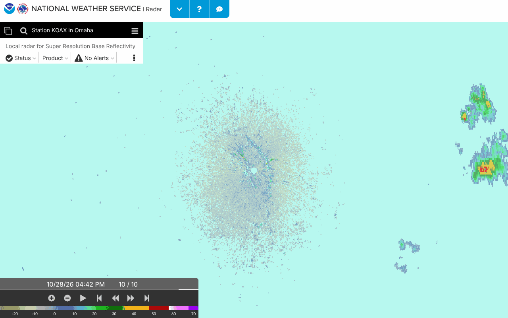
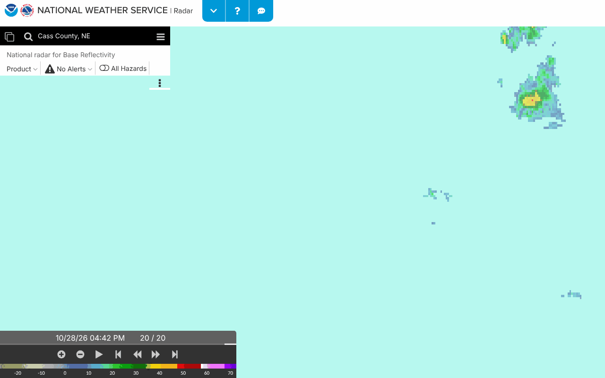

# Can the Radar card link to the interactive radar centred on the drop zone?

**Not for a single-station (KOAX) view. Yes for the national mosaic, which is a
different product.** Read from radar.weather.gov's own JavaScript on
2026-09-23; **not** observed in a browser, for the reason in
"What could not be checked".

This mattered because `docs/open-questions.md` left "approach 3" open on the
grounds that the site's `?settings=v1_<base64>` parameter was opaque. It is not
opaque: it is base64 of a JSON object, and both the code that builds it and the
code that reads it are in the site's bundles. What follows is the structure,
where it came from, and the one line of the viewer that decides the question.

No link shipped. The reason is at the end; the candidate URLs a person should
open are in "What a person should check".

## What the parameter encodes

`?settings=v1_` + `btoa(JSON.stringify(object))`. The object, as the viewer
reads it (`cmi-radar.eb3ff2a6.js`, `case"v1"`), with the store key each field
is committed to:

| JSON path | store key | what it does |
|---|---|---|
| `agenda.id` | `agenda` | `"local"` (one radar station), `"national"` (mosaic) or `"weather"` (mosaic plus a marker and forecast for a point) |
| `agenda.center` | `center` | map centre, **`[lon, lat]`**; rejected unless a 2-array with lon in ±180 and lat in ±90 |
| `agenda.zoom` | `zoom` | Web Mercator zoom; rejected only if `isNaN`; the store's own bounds are `min:3, max:20`, default `4` |
| `agenda.location` | `location` | `[lon, lat]` of the marker on the `"weather"` agenda |
| `agenda.station` | `local/station` | radar id, `"local"` agenda only |
| `agenda.layer` | `local/layerName` on `"local"`, `nationalMap` otherwise | e.g. `sr_bref` (super-res base reflectivity) for a station, `bref_qcd` for the mosaic |
| `agenda.filter` | `local/filter` | `"WSR-88D"` |
| `animating` | `setAnimating` | loop on/off |
| `base` | `baseMap` | `"standard"` |
| `county`, `cwa`, `state`, `artcc`, `rfc` | boundary overlays | booleans |
| `menu`, `menudis`, `controldis` | menu shown / disabled, controls disabled | booleans |
| `shortFusedOnly` | `alerts/setShortFusedOnly` | `true`, `false`, `"storm-based"` or `"hazards"` |
| `opacity.{alerts,local,localStations,national}` | opacities | 0–1 |

Every field is optional: the reader commits a key only when the path is
present (`n(key, value)` is a no-op on `undefined`).

The site's own "Enhanced KOAX Radar" button, on the page this app links to,
builds exactly this (`main.e067462b.js`, computed `enhancedUrl`):

```js
"/?settings=v1_"+btoa(JSON.stringify({agenda:{id:"local",center:this.locationMetadata.rdrLonLat,zoom:7,filter:"WSR-88D",layer:"sr_bref",station:this.locationId,transparent:!0,alertsOverlay:!0,stationIconsOverlay:!0},animating:!1,base:"standard",county:!1,cwa:!1,state:!1,menu:!0,shortFusedOnly:!0,opacity:{alerts:.8,local:.6,localStations:.8,national:.6}}))
```

`rdrLonLat` comes from a station table compiled into the same bundle; its KOAX
entry is `rdrLonLat:[-96.3667,41.3203]`, the figures in `SITE.radarSite`, so
`center` is `[lon, lat]` and the site centres its own link on the radar.

Two things a URL builder would have to get right, both read from the code:

- The blob is read back with `JSON.parse(atob(...))` after vue-router's query
  parser, which replaces `+` with a space before decoding
  (`e.replace(/\+/g," ").split("=")`). Standard base64 can contain `+`, so the
  blob must be percent-encoded, as the site's own `$router.replace` does.
  Trailing `=` padding is safe: the parser rejoins everything after the first
  `=`.
- The `v1_` prefix is a version; anything else logs
  `Unknown bookmark settings version` and applies nothing.

## The line that decides it

When a bookmark selects the `"local"` agenda, the reader dispatches
`persist/addBookmarkSuppress("local")`, and the local-radar layer component
watches the station list with that flag set. Once the list has loaded
(`api.weather.gov/radar/stations`, fetched asynchronously) it runs:

```js
var n=t.zoom===t.zoomDefaults.default?t.zoomDefaults.focus:t.zoom;
t.panTo({center:t.stationData.coordinates,zoom:n,duration:0})
```

`stationData.coordinates` is the radar's position from the API (KOAX:
`[-96.3668, 41.32027]`). So in single-station mode the map is re-centred on the
radar after load **whatever `agenda.center` said**. The zoom survives, unless it
is the default `4`, in which case it becomes `7`. The `/station/KOAX` quickset
path goes through the same watcher and has no centre of its own.

The `"national"` and `"weather"` agendas do not pass through that watcher. For
them the reader commits `center` and `zoom` and then reverse-geocodes the
centre into the search box (`search/geolocateSelected`); nothing re-centres.
A DZ-centred link is therefore possible **only** on the mosaic — which is not
KOAX's radar, and the Radar card's link exists to land the reader on KOAX's
radar.

## Also worth knowing

**The card's current link does not open the interactive radar.** The site's
routes (`main.e067462b.js`):

| route | path and aliases | shows |
|---|---|---|
| `enhanced` | `/`, `/station/:id`, `/station/:id/enhanced`, `/region/:id`, `/region/:id/enhanced`, `/location` | the interactive map (the CMI viewer) |
| `standard` | `/standard/:id?/:product?`, `/station/:id/standard`, `/region/:id/standard`, `/station/:id/:product/standard`, … | the RIDGE GIF loop with playback controls, and an "Enhanced … Radar" button |

`DATA_SOURCES.radar.url` is `/station/KOAX/standard`: the reader lands on the
same loop the card already shows, one click from the map. `/station/KOAX` opens
the map directly (quickset `{station:"KOAX"}` → local agenda, pan to KOAX,
zoom 7). Whether to change the link is a separate decision from this one; it is
noted here because the card says "Tap the image for the interactive radar".

**Zoom, if a station link is kept.** The DZ is 54.8 km (34.0 mi) from KOAX —
50.4 km south, 21.5 km east. (The DZ here, and in links B to E, is the
app's point of 2026-09-23, 40.8675, −96.11; since 2026-10-08 `SITE.dz` is
the landing area, 40.8703, −96.1085, about 300 m away, which changes none
of the above.) Web Mercator at 41.3° N:

| zoom | m/px | 390×600 px phone map | 1280×800 px desktop map |
|---|---|---|---|
| 7 (site default) | 919 | 358 × 551 km | 1176 × 735 km |
| 8 | 459 | 179 × 276 km | 588 × 367 km |
| 9 | 230 | 90 × 138 km | 294 × 184 km |
| 10 | 115 | 45 × 69 km | 147 × 92 km |

Centred on KOAX, the DZ stays on a phone screen through zoom 9 (69 km of the
138 km height lies south of centre) and leaves it at zoom 10. None of this was
seen rendered.

## How this was determined

All on 2026-09-23, with curl through the sandbox proxy:

- `https://radar.weather.gov/` and `https://radar.weather.gov/station/KOAX/standard`
  — the same 28,400-byte SPA shell (`cmp` identical), loading one bundle,
  `/main.e067462b.js`. `window.__INITIAL_STATE__` in the shell sets
  `cmiRadarUrl` to `/cmi-radar`.
- `https://radar.weather.gov/main.e067462b.js` (489,599 bytes): the
  `enhancedUrl` encoder, the station table with `rdrLonLat`, the route table,
  `convertPathToQuickset`, the vue-router query parser, and the Bookmarks help
  text ("The URL will automatically update as you select the view and
  settings. You may bookmark the URL to return later to the same view").
- `https://radar.weather.gov/cmi-radar/cmi-radar.eb3ff2a6.js` (2,465,211
  bytes): the `case"v1"` reader, the `encodedBookmark` getter that writes the
  same shape back into the URL as the user pans, the `center` and `zoom`
  mutations and their validators, the persist defaults
  `zoom:{default:4,min:3,max:20,focus:7}`, the agenda table
  (`local`: layers `local, alerts, stations`; `national`: `national, alerts`;
  `weather`: `alerts, marker, national`), and the station-list watcher quoted
  above.
- `https://api.weather.gov/radar/stations/KOAX` — `[-96.3668, 41.32027]`,
  `stationType: WSR-88D`; the coordinates the pan lands on.
- `https://radar.weather.gov/?settings=v1_...` returns the same shell, so the
  parameter is handled client-side and a curl can say nothing about what it
  produces.

The encoder expression above was run under Node with KOAX's `rdrLonLat` to
produce link A below, and decoded back with `atob` to confirm the round trip.
The other candidates were produced the same way.

## What could not be checked when this was written

**None of these URLs had been opened in a browser when this was written**
(2026-09-23: Playwright's Chromium here did not trust the egress proxy's
CA). They were on 2026-10-28, below, and the reading held. The
re-centring is read from the viewer's source, not observed; in particular the
watcher is registered in the layer component's `created` hook without
`immediate`, so if the station list were already loaded before that hook ran
it would never fire and the bookmark's centre would stand. The list is fetched
from the API asynchronously, so that ordering is not expected in practice, but
"not expected" is all a code reading gives.

## What a person should check

Open each of these, on a desktop and on a phone. For each, note where the map
is centred, the zoom, whether the KOAX single-site product or the mosaic is
shown, and then read what the site itself wrote back into the address bar once
the map settled: paste `JSON.parse(atob(location.search.split('v1_')[1]))`
into the console. Its `agenda.center` is the definitive answer to whether the
centre in the link survived.

- **A — the site's own "Enhanced KOAX Radar" link**, reproduced byte for byte.
  Expected: KOAX single-site, centred on the radar, zoom 7.

  `https://radar.weather.gov/?settings=v1_eyJhZ2VuZGEiOnsiaWQiOiJsb2NhbCIsImNlbnRlciI6Wy05Ni4zNjY3LDQxLjMyMDNdLCJ6b29tIjo3LCJmaWx0ZXIiOiJXU1ItODhEIiwibGF5ZXIiOiJzcl9icmVmIiwic3RhdGlvbiI6IktPQVgiLCJ0cmFuc3BhcmVudCI6dHJ1ZSwiYWxlcnRzT3ZlcmxheSI6dHJ1ZSwic3RhdGlvbkljb25zT3ZlcmxheSI6dHJ1ZX0sImFuaW1hdGluZyI6ZmFsc2UsImJhc2UiOiJzdGFuZGFyZCIsImNvdW50eSI6ZmFsc2UsImN3YSI6ZmFsc2UsInN0YXRlIjpmYWxzZSwibWVudSI6dHJ1ZSwic2hvcnRGdXNlZE9ubHkiOnRydWUsIm9wYWNpdHkiOnsiYWxlcnRzIjowLjgsImxvY2FsIjowLjYsImxvY2FsU3RhdGlvbnMiOjAuOCwibmF0aW9uYWwiOjAuNn19`

- **B — A with `center` set to the DZ and `zoom` 9.** This is the test of the
  override. Expected from the code: KOAX single-site at zoom 9, but centred on
  the radar, with the DZ near the bottom of the screen. If instead it opens
  centred on Weeping Water, the reading above is wrong and a DZ-centred
  station link is possible after all.

  `https://radar.weather.gov/?settings=v1_eyJhZ2VuZGEiOnsiaWQiOiJsb2NhbCIsImNlbnRlciI6Wy05Ni4xMSw0MC44Njc1XSwiem9vbSI6OSwiZmlsdGVyIjoiV1NSLTg4RCIsImxheWVyIjoic3JfYnJlZiIsInN0YXRpb24iOiJLT0FYIiwidHJhbnNwYXJlbnQiOnRydWUsImFsZXJ0c092ZXJsYXkiOnRydWUsInN0YXRpb25JY29uc092ZXJsYXkiOnRydWV9LCJhbmltYXRpbmciOmZhbHNlLCJiYXNlIjoic3RhbmRhcmQiLCJjb3VudHkiOmZhbHNlLCJjd2EiOmZhbHNlLCJzdGF0ZSI6ZmFsc2UsIm1lbnUiOnRydWUsInNob3J0RnVzZWRPbmx5Ijp0cnVlLCJvcGFjaXR5Ijp7ImFsZXJ0cyI6MC44LCJsb2NhbCI6MC42LCJsb2NhbFN0YXRpb25zIjowLjgsIm5hdGlvbmFsIjowLjZ9fQ%3D%3D`

- **C — national mosaic (`bref_qcd`) centred on the DZ, zoom 9.** Expected:
  centred on Weeping Water, no station selected, the search box showing a
  reverse-geocoded place name.

  `https://radar.weather.gov/?settings=v1_eyJhZ2VuZGEiOnsiaWQiOiJuYXRpb25hbCIsImNlbnRlciI6Wy05Ni4xMSw0MC44Njc1XSwiem9vbSI6OSwibGF5ZXIiOiJicmVmX3FjZCJ9LCJhbmltYXRpbmciOmZhbHNlLCJiYXNlIjoic3RhbmRhcmQiLCJjb3VudHkiOmZhbHNlLCJjd2EiOmZhbHNlLCJzdGF0ZSI6ZmFsc2UsIm1lbnUiOnRydWUsInNob3J0RnVzZWRPbmx5Ijp0cnVlLCJvcGFjaXR5Ijp7ImFsZXJ0cyI6MC44LCJsb2NhbCI6MC42LCJsb2NhbFN0YXRpb25zIjowLjgsIm5hdGlvbmFsIjowLjZ9fQ%3D%3D`

- **D — "Weather for a location" with the marker on the DZ, zoom 9.**
  Expected: as C, plus a marker at the DZ and a forecast panel.

  `https://radar.weather.gov/?settings=v1_eyJhZ2VuZGEiOnsiaWQiOiJ3ZWF0aGVyIiwiY2VudGVyIjpbLTk2LjExLDQwLjg2NzVdLCJsb2NhdGlvbiI6Wy05Ni4xMSw0MC44Njc1XSwiem9vbSI6OSwibGF5ZXIiOiJicmVmX3FjZCJ9LCJhbmltYXRpbmciOmZhbHNlLCJiYXNlIjoic3RhbmRhcmQiLCJjb3VudHkiOmZhbHNlLCJjd2EiOmZhbHNlLCJzdGF0ZSI6ZmFsc2UsIm1lbnUiOnRydWUsInNob3J0RnVzZWRPbmx5IjpmYWxzZSwib3BhY2l0eSI6eyJhbGVydHMiOjAuOCwibG9jYWwiOjAuNiwibG9jYWxTdGF0aW9ucyI6MC44LCJuYXRpb25hbCI6MC42fX0%3D`

- **E — the same as D without a blob**, via the `/location` quickset, which the
  code fixes at zoom 7: `https://radar.weather.gov/location?lat=40.8675&lon=-96.11`
- **F — the interactive map for KOAX without a blob**, via the `/station/:id`
  alias: `https://radar.weather.gov/station/KOAX`

## Settled in a browser, 2026-10-28

Links A to F were opened in Playwright's Chromium through the sandbox's
proxy (the SPKI recipe in CLAUDE.md), at 1280 and 390 px, 20 seconds
after `domcontentloaded` each, by `scripts/radarLinks.mjs`. The first
run, in the morning, got the page but no map: its basemap style comes from
`basemapstyles-api.arcgis.com`, its radar tiles from
`opengeo.ncep.noaa.gov` and its search box asks `geocode.arcgis.com`, and
none was on the sandbox's allowlist (the tile requests retry without end,
so that run made hundreds of refused connections). The maintainer added
the three that afternoon and the map drew: the KOAX echoes, the station
icons, the animation's frames. Two things the earlier text assumed were
wrong, and the script now allows for both: the site never writes its
settled state back into the address bar (the URL stayed byte for byte the
one opened, on every link, map or no map), and the map is OpenLayers, not
Mapbox, so the centre is read from the first Vue component property with
`getCenter()`, which gives Web Mercator metres, converted to degrees. The
basemap's art (`cdn.arcgis.com`, sprites and glyphs) is still blocked, so
the map drew on a blank ground, which changes nothing below.

What each link settled to, the same at both widths
(`data/parity/radar-links-2026-10-28.jsonl`, one line per load):

| link | blob asked for | map centre and zoom once settled |
|---|---|---|
| A, KOAX at zoom 7 (the site's own link) | KOAX, 7 | −96.3668, 41.3203 (KOAX), 7 |
| B, KOAX with the centre on the DZ, zoom 9 | DZ, 9, station KOAX | **−96.3668, 41.3203 (KOAX), 9** |
| C, national mosaic centred on the DZ | DZ, 9 | −96.11, 40.8675 (the DZ), 9 |
| D, "Weather for a location" at the DZ | DZ, 9, marker | −96.11, 40.8675 (the DZ), 9 |
| E, `/location?lat&lon` | none | −96.11, 40.8675 (the DZ), 7 |
| F, `/station/KOAX` | none | −96.3668, 41.3203 (KOAX), 7 |

So the code reading holds: a station link is re-centred on the radar
once the station list loads, keeping only the zoom; "centred on the DZ"
and "KOAX's own product" cannot be had in one link. The mosaic and the
location views honour the centre. B's screen at 1280 px, the DZ's
latitude about 220 px below the middle:



and C's, the mosaic centred on the DZ (the search box reverse-geocoded it
to "Cass County, NE"):



## Why no link shipped

The task was a link that lands on KOAX's radar *and* is centred on the drop
zone. The viewer's own code makes those exclusive: selecting a station pans to
the station, and on 2026-10-28 a browser showed it doing so (above). The
two things that are possible — a DZ-centred mosaic (C, or D with a marker),
or a KOAX view at a zoom where the DZ is on screen — each change what the
reader lands on, and both have now been seen. Which, if either, the card
should link instead of the plain station view is the maintainer's call
(docs/open-questions.md, "Radar card"). When this was written neither had
been seen in a browser; shipping either would have been guessing at the
product on the strength of a code reading; better to hand the
decision, and the URLs to check it with, to someone who can open them.

If B confirms the override, the choice is between C/D/E as a *second* link
labelled as the mosaic (not KOAX), and F or A for the station view. A helper
for either is small — the encoder above is the whole format — and its tests can
decode the blob back and check the fields; what they cannot check is the pan.
