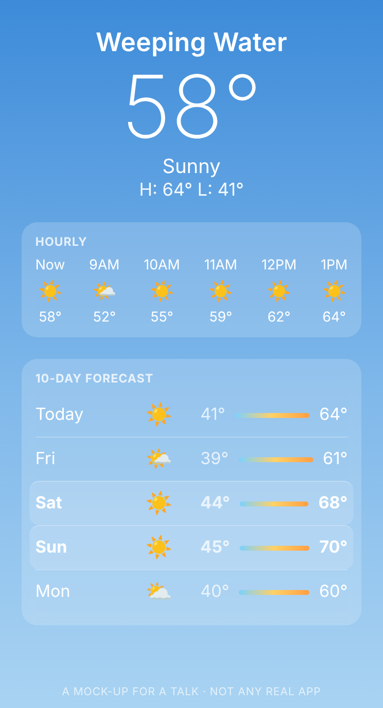
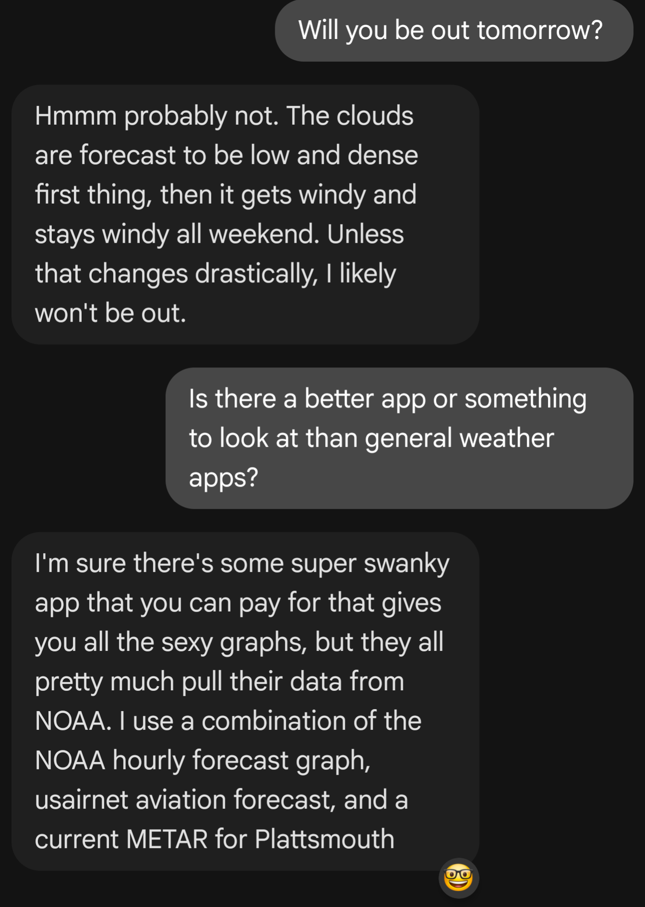
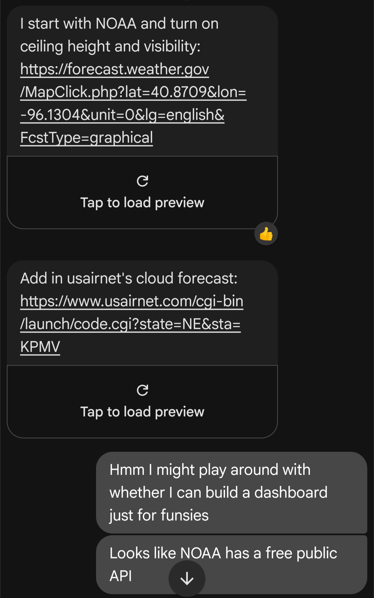
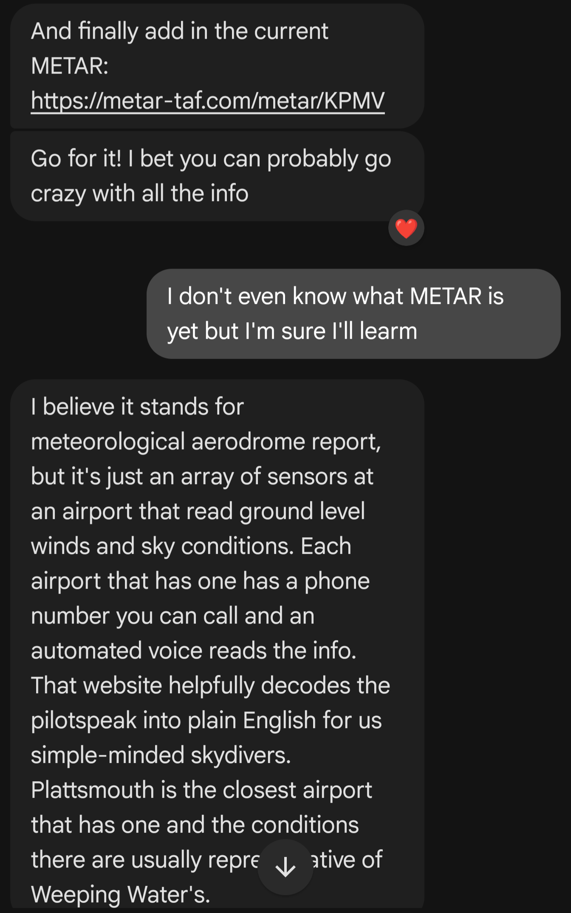
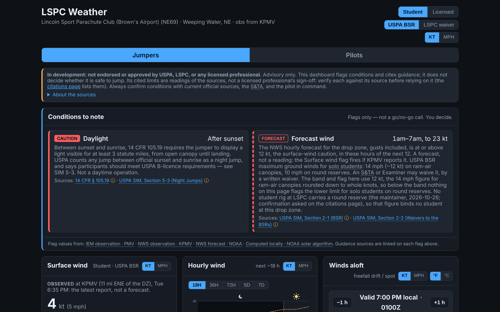

## What a weather app says {.app}

:::: {.columns}
::: {.column width="34%"}

:::
::: {.column width="66%"}
**Sunny, Saturday and Sunday.** Highs in the sixties. Nothing to decide.

A jumper's questions are different:

- How low is the cloud at nine in the morning, and does it lift?
- What is the wind doing at 3,000 feet, and at the top of the climb?
- What will it gust to at noon, and against which limit?
- Is any of that still true by the second load?

A general app has no row for any of them. The thread on the next slide is what happened when someone asked.

[The phone is a mock-up drawn for this talk, not any real app's forecast.]{.caption} [C31]{.ref}
:::
::::

::: notes
Set up the gap: a sunny icon is the whole forecast for most people. For a drop zone it is almost none of it. Say the mock is a mock. Then the thread.
:::

## Why I built it

::: {.chat}

:::

[A text thread, 2026: "Is there a better app?" The answer was three sites, read one by one. "I might play around with whether I can build a dashboard just for funsies."]{.caption} [C30]{.ref}

::: notes
Read the thread aloud, or let the room read it. The routine it describes, the NOAA hourly graph, usairnet's cloud forecast and the KPMV METAR, is the one the dashboard replaced; the next slide has the links. "I don't even know what METAR is yet" is where this started.
:::

## The sites behind it {.smaller}

What a jumper at this drop zone used to open one by one, and what the dashboard reads or is checked against. Every link is the one the live site offers.

:::: {.columns}
::: {.column width="50%"}
**Read by the dashboard**

- [NWS forecast for the drop zone](https://forecast.weather.gov/MapClick.php?lat=40.8703&lon=-96.1085) (forecast.weather.gov)
- [KPMV observations, NWS](https://forecast.weather.gov/data/obhistory/KPMV.html) and [at the Iowa Environmental Mesonet](https://mesonet.agron.iastate.edu/sites/site.php?station=PMV&network=NE_ASOS)
- [Open-Meteo](https://open-meteo.com/), winds aloft, cloud cover and the 10-day outlook (CC BY 4.0)
- [TAFs at aviationweather.gov](https://aviationweather.gov/data/taf/?ids=KOFF%2CKOMA%2CKLNK) and [NOAA's winds aloft (FD)](https://aviationweather.gov/data/windtemp/)
- [NWS radar, KOAX](https://radar.weather.gov/station/KOAX/standard)
:::
::: {.column width="50%"}
**Compared against, every day**

- [Mark Schulze's Winds Aloft](https://www.markschulze.net/winds/?lat=40.8703&lon=-96.1085), the tool jumpers already use
- [usairnet, KPMV](https://www.usairnet.com/cgi-bin/launch/code.cgi?state=NE&sta=KPMV), a second decode of the same METAR
- [aviationweather.gov's decoder](https://aviationweather.gov/data/metar/?ids=KPMV&hours=0), for the METAR and TAF parse
- [the USPA Skydiver's Information Manual](https://www.uspa.org/sim), fingerprinted daily
- [the dashboard itself](https://amelia-m.github.io/lspc-weather/), loaded in a browser at three widths
:::
::::

[C20, C26]{.ref}

::: notes
A quick orientation for anyone who flies or jumps: these are the sites. Mark Schulze's winds page is what the winds-aloft table is checked against; usairnet is where the club looked up the cloud forecast. Everything on the left is read in the reader's own browser.
:::

## What it is {.smaller}

:::: {.columns}
::: {.column width="55%"}

:::
::: {.column width="45%"}
**LSPC Weather**: a weather dashboard for one drop zone, the Lincoln Sport Parachute Club at Brown's Airport (NE69), Weeping Water, Nebraska.

- One page in place of a three-site routine: the NWS forecast, a cloud forecast and the KPMV METAR.
- Adds winds aloft for freefall drift and density altitude for the jump plane.
- Public, open source, on GitHub Pages. No account; the page reads public data in the browser, plus one small relay.

::: {.tiles}
::: {.tile}
[626]{.n} [commits since 26 June 2026]{.l}
:::
::: {.tile}
[276]{.n} [pull requests, every one merged]{.l} [C1, C3]{.ref}
:::
:::
:::
::::

::: notes
Open with the screenshot: this is what jumpers see on a Saturday morning. Point at "Flags only, not a go/no-go call. You decide." That line is the whole talk. Say the three sites it replaced and that it is a static page reading public data in the browser.
:::

## The rule that shaped everything

[From the working notes every agent reads first]{.kicker}

> The dashboard never gives a go/no-go verdict. It flags a condition and hands the reader the rule behind it, so a human can check it and decide.

> A flag fires on a limit some published source sets, or on a plain observed fact, or it does not fire at all.

A threshold nobody published cannot be checked, so it gets no flag, no warning colour, no worded judgement. [C6]{.ref}

Written down on 22 September, after four commits from 12 to 21 September that removed every number the app had invented. [C7, C10]{.ref}

::: notes
The first version had its own thresholds, like any weather app. The problem is the domain: a skydiver reading "caution" from an app wants to know whose caution. The fix was a rule, not a feature: if no published source sets the number, the app does not get to assert it. Quote the two lines. The rule is the first thing in the working notes every agent reads.
:::

## What the rule threw out

Ceiling bands · dew-point spread · precipitation chance · forecast storm chance · gust spread · winds-aloft speed bands · density-altitude bands · the last-load countdown · every "watch" band · two colour highlights · a storm colour · a "fog favorable" verdict · a derived sky verdict [C8]{.ref}

Each is listed in the notes by name, "so nobody reintroduces them believing they were an oversight."

The one exception: a licensed jumper's own limits, which the app always calls theirs. [C24]{.ref}

::: notes
Two of these survived an earlier sweep because they were colour and text rather than flags. A number is not the only way to assert something. That sentence is also in the notes. The list exists because an agent, or a reviewer bot, will suggest "add a caution when gusts exceed 20 knots" as a helpful small change, and it has to be refused with a reason the next agent can find.
:::

## Six months, dated from the history {.smaller}

| when | what |
|---|---|
| 26 Jun | first commit; features through the summer (17, 20 and 25 commits a month) |
| 12 Sep | the citations page: every USPA and FAA claim, with what the source says |
| 19 to 21 Sep | the no-verdict rule; invented thresholds removed |
| 22 Sep | the working notes (CLAUDE.md) and the open-questions file begin |
| 23 to 24 Sep | a daily check compares the app's METAR and TAF decoding with aviationweather.gov's |
| Oct | samplers and archives: forecasts kept to score later, sources compared every few hours (399 commits) |
| 17 Oct | the deployed site loaded in a browser every day at three widths |
| 20 Oct | a relay for the Air Force base's TAF, which no browser-readable feed carries |
| 5 Nov | the app's own flag levels put to the club's safety officer as a question |

[C1, C2, C10]{.ref}

::: notes
Every date here is the first commit touching the file, read from git log. The shape: a summer of features, then September turned into a question of trust, and October into measuring. The commit count jumped in October because measuring generates a lot of small, checked changes.
:::

## Who did what

::: {.tiles}
::: {.tile}
[520]{.n} [commits by a Claude agent, in four long sessions]{.l}
:::
::: {.tile}
[91]{.n} [by the project's own workflows]{.l}
:::
::: {.tile}
[13]{.n} [by Amelia, who decided]{.l}
:::
::: {.tile}
[31]{.n} [dated decisions quoted in the notes]{.l} [C4, C5, C23]{.ref}
:::
:::

::: {.cards}
::: {.card}
**Amelia decided.** Own thresholds on Licensed only (10 Oct). "Make it very clear" the wind card shows a report, not a forecast (30 Oct). Keep the sampler logging over seasons (30 Oct). Hold visibility to both rows of the rule (31 Oct). Findings logged durably (10 Nov). [C24]{.ref}
:::
::: {.card}
**Agents worked under written rules.** Four gates before a push. Prove a new test by breaking the thing it names. Every finding goes in the repository in the same piece of work, and a hook repeats that on every prompt. Two commits came from an OpenAI agent. [C22, C4]{.ref}
:::
:::

::: notes
The split is not "AI writes code, human reviews code". It is "human decides what may be asserted and what the project is for; agents build, measure and write up; the repository is the shared memory". The decisions are dated and attributed in the notes so a later agent can tell a rule from a habit. The hook was added after two investigations were reported only in chat and lost until asked for.
:::

## What went wrong, and what each left behind {.smaller}

| the fault | what changed |
|---|---|
| 23 Sep: seven observations arrived with an empty cloud decode; the dashboard showed "Clear" and VFR under a 2,700 ft overcast. Found from a screenshot of the live site. [C11]{.ref} | The sky is read from the METAR text first. A daily check compares the app's decode with another decoder's. |
| usairnet redesigned its page; a comparison parsed nothing for 17 days, because it was built never to fail. [C12]{.ref} | A quiet comparison now shows as a count on the parity page, and the notes say to read it. |
| 28 Oct: GitHub's runner image changed; the live-site check failed six times in two days before it started, and nobody read the issue. [C13]{.ref} | The runner is pinned. "A failing check that nobody reads is the same as no check." |
| A button sat 3 px off a 320 px page, only in the half hour before midnight; the daily check ran in the morning. [C14]{.ref} | A second leg checks the fixture build with the clock at 11:45 PM. |
| 7 Nov: a runner died with an hour's samples on it, unuploaded, and the next start was four hours off. [C15]{.ref} | One upload per sample; each run queues its successor. |

::: notes
Pick two to tell in full: the overcast, because it is the one that mattered to a jumper, and the runner image, because the lesson is about people, not code. Each row is a paragraph in the notes, dated, and the fix is a rule or a check, never "be more careful".
:::

## Checking the checkers

Two checks watch the project every day: a decoder comparison against aviationweather.gov and uspa.org, and the live site in a browser.

::: {.tiles}
::: {.tile}
[7 of 12]{.n} [decoder-check failures found something real]{.l}
:::
::: {.tile}
[1 of 8]{.n} [live-site failures was the site's]{.l}
:::
:::

Tallied on 7 November, every failure against what it turned out to be: [C16]{.ref}

| check | failed | real | the check's own | another host's bad minute |
|---|---|---|---|---|
| decoder comparison | 12 of 45 runs | 4 | 3 | 5 |
| live site | 8 of 148 runs | 1 | 6 (one cause) | 1 unexplained |

The five cries of wolf were each one bad answer from a server; one retry now covers four of the five kinds. uspa.org refused scripts for a day on 9 October and again on 9 November. [C27]{.ref}

::: notes
The point: a check that fails is only useful if someone reads why. Seven of twelve decoder failures found something, twice the app's own decoder, never shown to a reader. The live-site check was wrong six times for one reason that was not the site's. The verdict was: nothing to loosen, and take the tally again in a month.
:::

## The citations

Every USPA, CFR and FAA reference began as an AI recollection. [C17]{.ref}

- Each was then read at its source: the USPA manual on 22 September and every cited part again on 8 October; the federal regulations on 23 September and again on 3 November.
- 19 citations; a page that shows, per claim, what the section says, when it was read, and what a reading could not settle. [C18]{.ref}
- A daily check fingerprints every cited part, so a changed sentence at the source fails the daily check.
- The page takes an instructor's answers. The review is still waiting on the club's safety officer. [C19]{.ref}

::: notes
"Began as an AI recollection" is in the README in those words. The honest version of citing is: here is what we read, when, and here is the question only an instructor can answer. The flag levels themselves, "watch" and "caution", are the app's own words, and on 5 November they became a question on that page rather than a thing the app asserts.
:::

## The stack, in one slide {.smaller}

- **A static page**: React and TypeScript, built with Vite, deployed to GitHub Pages on every merge. 24,652 lines of source; 1,368 tests, all hermetic. [C20, C21]{.ref}
- **Data read in the browser** from public sources: the National Weather Service, Open-Meteo (credited wherever its data show, as its licence asks), the Iowa Environmental Mesonet, usairnet, NOAA's archives. [C20, C25]{.ref}
- **One small server**: a Cloudflare Worker relay for the Air Force base's TAF, which no browser-readable feed carries.
- **Ten GitHub workflows** that are not CI: daily decoder checks, a browser check of the live site, samplers every 17 minutes, hourly forecast keeping, daily archiving, a weekly data refresh.
- **The notes**: 22 documents, about 79,000 words, and a 9,200-word CLAUDE.md that every agent reads first. [C21]{.ref}
- A winds-aloft table that reproduces a widely used tool's (Mark Schulze's) within 4° and 1 kt, and a written account of every way it can differ. [C26]{.ref}

::: notes
Keep this to a minute. The unusual part is not the app, it is the measurement machinery around it and the size of the notes relative to the code: more words of notes than lines of source.
:::

## AI disclosure

- **Tools**: Claude Code, in cloud sessions, with GitHub, a sandbox with a browser, and an allowlisted network. Two commits on 1 October came from an OpenAI code agent. [C4]{.ref}
- **Models**, from the commit trailers: Claude Opus 5.5 on 296 commits, Claude Fable 5.1 on 137, Claude Opus 5 on 38, Claude Opus 4.8 on 22, Claude Haiku 4.5 on 2. [C5]{.ref}
- **What they did**: wrote the code, the tests, the workflows and the notes; ran the comparisons; read the sources and recorded when; drafted this deck and its claims table.
- **How the work was reviewed**: four gates on every change, run again by CI on every pull request; the maintainer's decisions dated in the notes; the citations read at their sources and the review handed to an instructor; this deck's claims checked against the repository by a separate agent before it was shown.

::: notes
Say plainly which parts of this talk an agent wrote: the deck and the claims table, from the repository, and that you read both.
:::

## What you could reuse

1. **A rule about what the software may assert**, written down, with the list of what it removed, so the next agent does not add it back.
2. **The repository as the shared memory**: every finding in a file, dated and attributed; a hook that reminds the agent on every prompt.
3. **Checks against other decoders and the live site**, not only against fixtures; then a tally of how often each cries wolf.
4. **Prove a test by breaking the thing it names.**
5. **Hand the questions a document cannot settle to the people who can**, on a page that takes their answers.

::: notes
Close on the first and the last. The rule is the design; the questions page is the humility. Everything in between is plumbing you can copy from the repository.
:::

## Appendix {.center}

## The numbers, with their commands {.smaller}

| figure | command, read 2026-11-11 |
|---|---|
| 626 commits on `main`, first 2026-06-26 | `git rev-list --count origin/main`; `git log --reverse --format=%ad` |
| 17 / 20 / 25 / 118 / 399 / 47 by month | `git log --format=%ad --date=format:%Y-%m \| sort \| uniq -c` |
| 275 PRs, all merged; 13 issues | GitHub REST, `pulls?state=all`, `issues?state=all` |
| 520 / 87 / 12 / 4 / 2 commits by author | `git shortlog -sn --no-merges origin/main` |
| models on 296 / 137 / 38 / 22 / 2 commits | `git log --format=%b \| grep -i Co-Authored-By` |
| 1,368 tests in 90 files | `npm test` |
| 24,652 source lines, 16,958 test lines | `find src tests -name '*.ts*' \| xargs wc -l` |
| 22 docs, 79,000 words; CLAUDE.md 9,200 | `wc -w docs/*.md CLAUDE.md` |

[C1 to C5, C20, C21]{.ref}

## The workflows {.smaller .tight}

| workflow | when | what |
|---|---|---|
| Deploy to GitHub Pages | every push to `main` | builds and publishes the site, then starts the live-site check |
| CI | pull requests | the four gates |
| Sky decode parity | daily | the METAR and TAF decode against aviationweather.gov; the Pilots links; the SIM fingerprints |
| Live site check | daily and after deploys | every page at 1280, 390 and 320 px; a second leg with the clock at 11:45 PM |
| Source comparisons | eight times a day | the winds-aloft table against Mark Schulze's; the observation against usairnet |
| Parity summary | daily | combines the comparisons, archives them, publishes the parity page |
| Surface-wind sample | continuous, every 17 min | four forecasts against KPMV's reports |
| Forecast keeper | hourly | keeps what the forecasts said, to score later |
| Ceiling data refresh | weekly | NDFD and Open-Meteo archives, the error pages rebuilt |
| Cloud-cover fetch | by hand | months of archives in minutes on a runner |

[C20]{.ref}

## The overcast of 23 September, in full {.smaller}

api.weather.gov served seven consecutive KPMV observations with an empty cloud-layer decode and an empty description while the METAR text read OVC027 to OVC035. Re-read twenty minutes later the same seven were still empty while the next report was decoded: a gap, not a lag. usairnet's decode of the same METAR read "Solid Overcast at 2700 ft". The dashboard showed "Clear", "No ceiling" and VFR under a 2,700 ft overcast, with no flag, found from a screenshot of the deployed site, which no sandbox check had covered.

Since then: the sky is parsed from the METAR text and the API's decode is used only when the text has none; an empty sky means *not reported*, and the app never shows VFR from a report with no ceiling in it; the Data health card grades the two decodes against each other; and a workflow compares the app's parse with aviationweather.gov's every morning. [C11]{.ref}

## How a day's work goes (3 to 10 November) {.smaller}

- A question from the maintainer ("is IFR structurally incompatible with the visibility rule? double check the CFR") became a reading of the regulation through the eCFR API, a comparison the flag now prints, and a new citation, with its reading date logged.
- "Draft the flag levels question for the S&TA" became a Part B entry on the citations page that derives its wording from the flags' own constants, so the question cannot drift from the badges.
- "Make sure this doesn't happen again" after a lost runner became one artifact per sample and a self-queuing job, checked locally at a 30-second cadence, which found a second bug in the loop's arithmetic.
- Each change: four gates, a test proved by breaking, a review pass, a pull request, a merge, a deploy, the live-site check, and a paragraph in the notes. 28 pull requests in eight days. [C28]{.ref}

::: notes
This is the session that drafted this deck, allowed as a source by the maintainer. The pattern is the same every day: a question, a measurement, a change held to a test, a note.
:::
